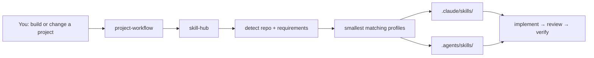

<div align="center">

# Skill Hub

### Automatic project-local Agent Skills manager for Claude Code and OpenAI Codex

**Detect the repository, install only the skills it actually needs, keep Claude Code and Codex aligned, and preserve local edits — without turning global context into a prompt dump.**

[](https://github.com/arttvad9r/skill-hub/actions/workflows/skillhub.yml)
[](https://github.com/arttvad9r/skill-hub/releases/latest)
[](LICENSE)
[](https://www.python.org/)

[Quick start](#quick-start) · [Browse profiles](CATALOG.md) · [Recipes](docs/recipes.md) · [Safety](#safe-by-default) · [Architecture](docs/architecture.md)

</div>

---

## 30-second tour

```console
$ skillhub detect .
Facts: android, jetpack-compose
Base profiles: android-compose-app

$ skillhub install --project . --profile android-compose-app
Skills: 3 in claude, codex; copied 6, removed 0

$ skillhub status .
android-cli                      claude=current, codex=current
android-emu                      claude=current, codex=current
edge-to-edge                     claude=current, codex=current
```

The same project manifest drives project-local skills for both Claude Code and OpenAI Codex. Skill Hub keeps selection conservative, records provenance, and refuses to silently overwrite local edits.

Most Agent Skills repositories help you **find skills**. Skill Hub handles the operational part after that:

- Which skills should this repository receive?
- How do Claude Code and Codex get the same project capabilities?
- How do you keep global context small?
- How do you update skills later without overwriting project-specific edits?
- How do you know where a vendored skill came from and which revision you installed?

Skill Hub keeps only two small routing skills global. Everything specialized is selected through curated profiles and copied into the project itself.



Current catalog: **118 skills across 71 profiles**. Browse all of them in [CATALOG.md](CATALOG.md).

## Quick start

Requirements: **Git**, **Python 3.11+**, and Claude Code and/or Codex. Linux is the primary development environment; macOS is covered by CI. On Windows, WSL is the recommended path for now.

Install a pinned release:

```bash
git clone --branch v0.4.1 --depth 1 https://github.com/arttvad9r/skill-hub.git ~/SkillHub
~/SkillHub/bin/skillhub bootstrap
```

`bootstrap` installs only:

```text
~/.claude/skills/project-workflow/   # Claude Code
~/.claude/skills/skill-hub/
~/.codex/skills/project-workflow/    # Codex
~/.codex/skills/skill-hub/
~/.local/bin/skillhub                # symlink to this checkout
```

It does **not** replace `~/.claude/CLAUDE.md` or `~/.codex/AGENTS.md` unless you explicitly pass `--preferences`.

Only use one agent? Install the routing layer for that target:

```bash
~/SkillHub/bin/skillhub bootstrap --target claude
# or
~/SkillHub/bin/skillhub bootstrap --target codex
```

Check the command:

```bash
skillhub --version
command -v skillhub
```

If your shell does not include `~/.local/bin` in `PATH`, either add it or use `~/.local/bin/skillhub` directly.

### Then just work normally

Open Claude Code or Codex in a repository and describe the project/task. The global `project-workflow` router knows when specialist capabilities are needed and delegates selection to `skill-hub`.

For example:

> Create a minimal Android app with Kotlin and Jetpack Compose. Keep the repository easy for another agent to continue and verify the build before finishing.

For a new Compose project, the routing chain resolves to the lean `android-compose-app` profile:

```text
project-workflow
  → skill-hub
    → android-compose-app
      → android-cli
      → android-emu
      → edge-to-edge
```

The project receives managed copies for both agents plus a manifest:

```text
my-project/
├── .skillhub.toml
├── .claude/skills/
│   ├── android-cli/
│   ├── android-emu/
│   └── edge-to-edge/
└── .agents/skills/
    ├── android-cli/
    ├── android-emu/
    └── edge-to-edge/
```

If Claude Code was already running when `.claude/skills/` was created, use `/reload-skills`. Codex normally notices project-local skills; restart the session if it does not.

## Try the CLI without global bootstrap

Want to inspect the project before writing anything to your home directory?

```bash
git clone https://github.com/arttvad9r/skill-hub.git ~/SkillHub
~/SkillHub/bin/skillhub profiles
~/SkillHub/bin/skillhub show android-compose-app
~/SkillHub/bin/skillhub detect /path/to/project
```

You can even install into only one agent target:

```bash
~/SkillHub/bin/skillhub install \
  --project /path/to/project \
  --profile android-compose-app \
  --target codex
```

## See the lifecycle

Detect objective repository facts:

```console
$ skillhub detect .
Facts: android, jetpack-compose, dockerfile
Base profiles: android-compose-app, docker-build
```

Inspect before installing:

```console
$ skillhub show android-compose-app
android-compose-app: Minimal Jetpack Compose application profile...
- android-cli
- android-emu
- edge-to-edge
```

Install and inspect ownership:

```console
$ skillhub install --project . --profile android-compose-app
Skills: 3 in claude, codex; copied 6, removed 0

$ skillhub status .
android-cli                      claude=current, codex=current
android-emu                      claude=current, codex=current
edge-to-edge                     claude=current, codex=current
```

If you edit a managed copy locally, Skill Hub notices:

```console
$ skillhub status .
android-cli                      claude=current, codex=modified-locally

$ skillhub sync .
ERROR: Refusing to overwrite or delete skills that skillhub did not write unchanged; ...
```

Later, if the Hub changes:

```bash
git -C ~/SkillHub fetch --tags
git -C ~/SkillHub checkout v0.4.1
skillhub bootstrap        # refresh the two global routers if needed
skillhub status .
skillhub sync .
```

`sync` refuses to overwrite locally modified copies unless `--force` is explicitly used. Unmanaged skills are never silently adopted or deleted.

## Why this is different

| | Typical skills collection | Skill Hub |
| --- | --- | --- |
| Global context | Often many installed skills | **2 small routers** |
| Project selection | Manual / install-by-browsing | **Profiles + conservative detection** |
| Claude + Codex | Usually separate setup | **One manifest, per-target ownership** |
| Updates | Copy again / replace files | **Explicit `status` + safe `sync`** |
| Local edits | Easy to overwrite | **Detected and preserved by default** |
| Provenance | Varies | **Source + pinned revision + license** |
| Project isolation | Depends on installer | **Copies live inside the repository** |
| Verification | Usually prompt-level | **Regression tests + real-agent E2E harnesses** |

The goal is not to own the biggest skill catalog. The goal is to make a **small, high-signal set of capabilities predictable to operate across real repositories**.

## Starter recipes

| You are working on… | Start with… | Add when factual |
| --- | --- | --- |
| Android / Compose app | `android-compose-app` | `android-navigation`, `android-testing`, `android-security`, `android-performance` |
| Web UI / site | `design-web` | `security-core` for sensitive flows |
| General app/desktop UI | `design` | focused platform profile |
| Interactive UI motion | `motion-ui` | `design-web` when broader web design work is also needed |
| Programmatic video | `motion-video` | `motion-video-product`, `motion-video-graphics`, `motion-data`, `motion-webgl`, or `motion-math` for the matching job |
| Dockerized service | `docker-project` | `fastapi`, `security-core` |
| Existing Docker Compose stack | `docker-compose` | `docker-build`, `docker-safety` |
| Game project | `game-core` | one genre + only relevant discipline packs |
| LLM/RAG/tool-using app | relevant app profile | `security-llm` |
| Accessibility work | `mobile-accessibility` or `android-accessibility` | platform-specific packs |

More examples and “when not to install it” guidance: [docs/recipes.md](docs/recipes.md).

## Browse the catalog

The generated [CATALOG.md](CATALOG.md) lists every profile and skill directly on GitHub:

- profile → description → resolved skill count;
- skill → category → source → pinned revision → license.

The library currently has especially deep coverage for **Android, UI/design, motion/video, game development, accessibility, security, Docker, and FastAPI**. It is deliberately not a generic “everything for every framework” dump.

Engine-specific game packs and broad framework coverage such as React/Node/Rust are not bundled just to inflate the count. New sources are added when they provide enough specialist signal and have usable provenance/licensing.

## Safe by default

`.skillhub.toml` (manifest v3) tracks ownership separately for Claude and Codex:

- hash of the copy Skill Hub wrote;
- source and revision for each agent target;
- installed profiles and explicit skills;
- active targets.

That lets `status` distinguish:

- `current` — managed copy matches the Hub;
- `outdated` — Hub changed while the project copy stayed untouched;
- `modified-locally` — project copy changed after installation;
- missing / profile-added / profile-removed states.

Skill names and managed paths are validated, destinations are confined to project skill directories, and installable skill packages containing symlinks are rejected.

### What code can a skill contain?

A skill can include `SKILL.md`, references, assets, or helper scripts. Some upstream skills may execute project tooling or obtain platform tooling when the agent explicitly follows them. Treat installed skills like development dependencies: review the source/provenance for sensitive environments and do not grant agents more machine access than the task requires.

See [THIRD_PARTY.md](THIRD_PARTY.md), [SECURITY.md](SECURITY.md), and [docs/architecture.md](docs/architecture.md).

## Update or uninstall

Update the Hub intentionally rather than following a moving checkout blindly:

```bash
git -C ~/SkillHub fetch --tags
git -C ~/SkillHub checkout v0.4.1
~/SkillHub/bin/skillhub bootstrap
skillhub status /path/to/project
skillhub sync /path/to/project
```

Remove a project profile or target:

```bash
skillhub remove --project . --profile design-web
skillhub remove --project . --target codex
```

Remove the global routing layer installed by this checkout:

```bash
~/SkillHub/bin/skillhub unbootstrap
```

`unbootstrap` removes only the two routing skills and the `~/.local/bin/skillhub` link that match this checkout. **User preference files are left untouched.**

If `bootstrap --preferences FILE --force` replaces an existing user config, Skill Hub first writes a timestamped backup next to that file.

## Optional user preferences

Personal agent preferences are deliberately not a public default. To use one shared user-level preference file for the selected agents:

```bash
mkdir -p ~/.config/skillhub
cp ~/SkillHub/global-config/user-preferences.example.md ~/.config/skillhub/user-preferences.md
$EDITOR ~/.config/skillhub/user-preferences.md
skillhub bootstrap --preferences ~/.config/skillhub/user-preferences.md
```

Use `--target claude` or `--target codex` if the preference file should only be copied to one agent.

## CLI at a glance

| Command | Purpose |
| --- | --- |
| `skillhub --version` | Show the installed CLI version |
| `skillhub bootstrap` | Install/refresh the minimal global routing layer |
| `skillhub unbootstrap` | Remove this checkout's global routing layer safely |
| `skillhub profiles` | List curated profiles |
| `skillhub show <profile>` | Resolve a profile to its concrete skills |
| `skillhub detect [project]` | Detect conservative repository facts/base profiles |
| `skillhub install ...` | Add profiles or explicit skills to a project |
| `skillhub status [project]` | Report current/outdated/modified/missing state |
| `skillhub sync [project]` | Refresh unchanged managed copies explicitly |
| `skillhub remove ...` | Remove profiles, explicit skills, or agent targets |
| `skillhub verify` | Validate Hub metadata, profiles, licenses, and package safety |

Run `skillhub <command> --help` for exact flags.

## Agent workflow

The two global routing skills form a deliberately small control plane:

```text
user request
    ↓
project-workflow
    ├─ discovery / bootstrap / plan
    ├─ implementation / debugging
    ├─ review / audit / verification
    └─ handoff / resume
            ↓
        skill-hub
            ↓
   project-local specialist skills
```

The workflow follows the same broad direction as current agent guidance: concise repository instructions, progressive disclosure for specialist knowledge, and executable feedback loops instead of ever-growing prompt scaffolding.

- OpenAI: [Rethinking skills and prompts for GPT-6 Astra](https://developers.openai.com/blog/rethinking-skills-and-prompts-for-gpt-6-astra)
- OpenAI: [Using skills to accelerate OSS maintenance](https://developers.openai.com/blog/skills-agents-sdk)
- Anthropic: [Agent Skills](https://www.anthropic.com/research/skills)
- Ponytail 5: [smallest complete change, connected-code review, and repository-audit ideas](https://github.com/DietrichGebert/ponytail/releases/tag/v5.0.0), adapted here into Skill Hub's multi-agent progressive-disclosure workflow rather than bundled as a dependency.

## Verification and evals

Deterministic checks run in GitHub Actions:

```bash
./bin/skillhub verify
python3 tools/render_catalog.py --check
python3 -m unittest discover -s tests -v
```

The repository also contains real-agent bootstrap eval harnesses:

```bash
python3 evals/codex_bootstrap_e2e.py
python3 evals/claude_bootstrap_e2e.py
```

They give the agent a product request rather than telling it which skills to invoke, then verify routing, lean profile selection, build output, Git behavior, device constraints, and Skill Hub status.

Latest recorded runs and limitations: [evals/RESULTS.md](evals/RESULTS.md).

## Compatibility

| Environment | Status |
| --- | --- |
| Claude Code | Supported; dedicated real-agent eval harness |
| Codex CLI | Supported; dedicated real-agent eval harness |
| Linux | Primary development/test environment |
| macOS | Deterministic CI coverage |
| Windows | Not directly tested; use WSL for the current bootstrap/path model |

## Repository layout

```text
bin/             dependency-free CLI
profiles/        curated capability packs
skills/          inactive specialist-skill library
global-skills/   the two minimal routers
catalog.toml     source / revision / license metadata
CATALOG.md       generated browser-friendly catalog
tests/           deterministic installer regression tests
evals/           real-agent behavior evals
tools/           repository maintenance helpers
sources/         upstream license and provenance records
global-config/   optional user-preference example
```

## Contributing

New skills and profiles are welcome when they fill a real capability gap, have a precise trigger, and have redistributable licensing. See [CONTRIBUTING.md](CONTRIBUTING.md) for the smallest valid PR workflow.

If you cannot run a quota-bearing real-agent eval, say so in the PR. Deterministic checks are the baseline; a maintainer can run the agent eval when it is actually required.

## Roadmap

Near-term areas where contributions are useful:

- more high-signal framework/platform profiles instead of bulk imports;
- stronger source-update/provenance automation;
- broader real-agent eval scenarios beyond Android bootstrap;
- better first-class support for non-Unix environments where the lifecycle can stay equally safe.

For common questions, see [docs/faq.md](docs/faq.md).

## License

Original Skill Hub code and project-owned skills are licensed under the [Apache License 2.0](LICENSE). Vendored third-party material keeps its original license; see [THIRD_PARTY.md](THIRD_PARTY.md).

---

If Skill Hub makes your agent setup simpler, consider starring the repository — it helps other Claude Code and Codex users find it.
